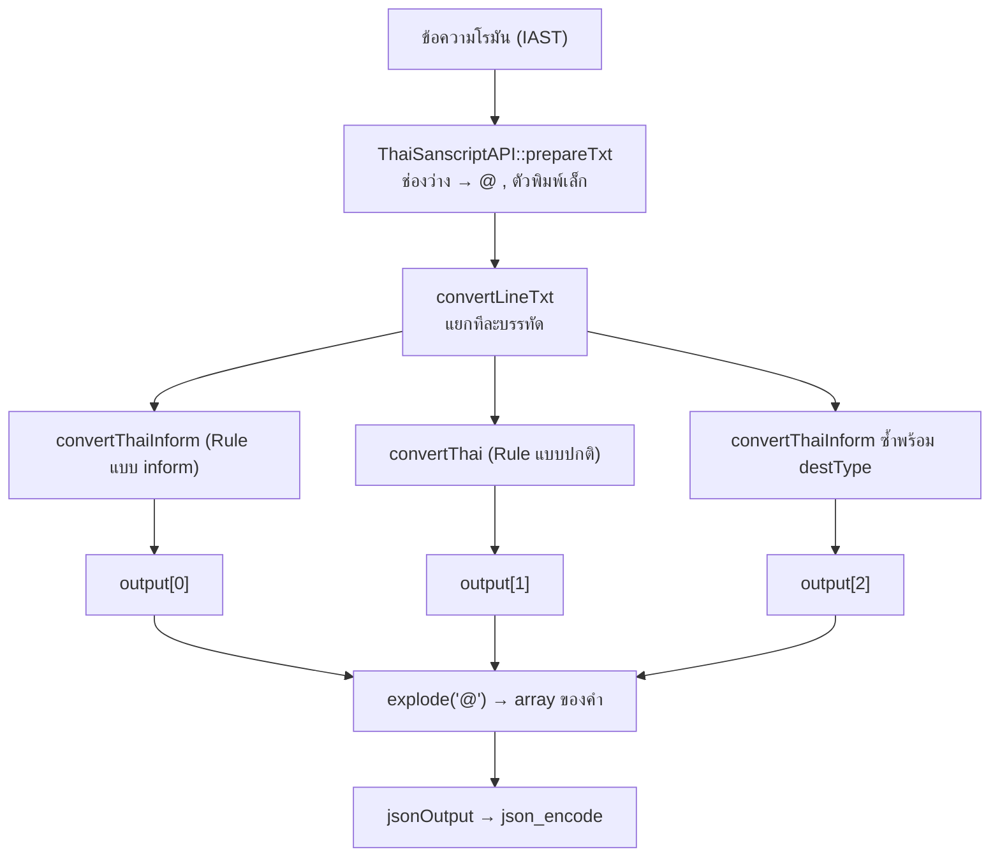

# ThaiSanscript – การทำงาน

ไลบรารี PHP (namespace `ThaiSanskrit`) สำหรับ**แปลงอักษรโรมัน (IAST) สันสกฤต/บาลี เป็นอักษรไทย** (และลาวเป็นตัวเลือก)
ผู้เขียน: Thanakrit.P

## 1. โครงสร้างไฟล์

| ไฟล์ | คลาส | หน้าที่ |
|---|---|---|
| `include.php` | – | `require_once` ไฟล์ทั้งหมด (รวม `Sanscript.php` ซึ่งเป็นไลบรารีแปลง Devanagari ↔ IAST) |
| `ThaiSanscriptAPI.php` | `ThaiSanscriptAPI` | จุดเข้าใช้งาน เตรียมข้อความ แยกบรรทัด/คำ เรียก Rule และจัดรูปผลลัพธ์ (JSON) |
| `ThaiSanscriptRule.php` | `ThaiSanscriptRule` | กฎการแปลง**แบบปกติ** (สระ/ะ ตามการออกเสียงไทย เช่น `ั` จากวิสรรค) |
| `ThaiSanscriptInformRule.php` | `ThaiSanscriptInformRule` | กฎการแปลง**แบบ inform** (คงรูปอักษร ใช้พินทุ `ฺ` กำกับพยัญชนะที่ไม่มีสระ) |
| `ThaiSanscript.php` | `ThaiSanscript` | ตารางแมปอักษร (พยัญชนะ สระ เลข สัญลักษณ์) และกฎอนุสวาร/จันทรพินทุ |
| `Util.php` | `Util` | ฟังก์ชันแปลงทีละขั้น (แทนที่ข้อความ, สลับสระหน้า, แปลงเป็นลาว ฯลฯ) |
| `ThaiVisargaRuleConvert.php` | `ThaiVisargaConvert` | กฎการเปลี่ยน `ะ` เป็น `ั`/`ร`/ตัดทิ้ง ในแบบปกติ |
| `Sanscript.php` | `Sanskrit\Sanscript` | แปลงระหว่างอักษรอินเดีย/โรมันหลายระบบ (ใช้ผ่าน `Thaisans_adapter`) |

## 2. ภาพรวมการไหลของข้อมูล



เมธอดสำคัญของ `ThaiSanscriptAPI`:

| เมธอด | ทำอะไร |
|---|---|
| `prepareTxt($txt)` | แทนที่ช่องว่างด้วย `@` และแปลงเป็นตัวพิมพ์เล็ก |
| `convertThai($txt, $lang, $destType)` | เรียก `ThaiSanscriptRule::convert` |
| `convertThaiInform($txt, $lang, $destType)` | เรียก `ThaiSanscriptInformRule::convert` |
| `convertLineTxt($txt, $lang, $destType)` | แยกบรรทัด แล้วคืนอาร์เรย์ 3 ชุด (ดูหัวข้อ 5) |
| `jsonOutput($txt, $lang, $destType)` | `prepareTxt` → `convertLineTxt` → `json_encode` |
| `transliterationTracking($romanize, $mode)` | แปลงแบบแสดงทุกขั้นตอน แล้วเทียบกับ `convert` ปกติ |

พารามิเตอร์:
- `$lang`: `"sans"` (สันสกฤต, ค่าเริ่มต้น) หรือ `"pali"`
- `$destType`: `"thai"` (ค่าเริ่มต้น) หรือ `"lao"`

## 3. ขั้นตอนใน `ThaiSanscriptRule::convert` (แบบปกติ)

ลำดับขั้นตอนสำคัญ เพราะแต่ละขั้นแทนที่ข้อความต่อจากผลของขั้นก่อน:

| # | ขั้นตอน | ตัวอย่าง / หมายเหตุ |
|---|---|---|
| 1 | `convertAvagarahaRemove` | ลบ `'` (อวครหะ) |
| 2 | `convertRomanChandrabinduToSingle` | รวม `m̐` ให้เป็นอักขระเดียว |
| 3 | `convertNumber` | `0-9` → `๐-๙`, `|` → `ฯ`, `||` → `๚` |
| 4 | `convertRomanizeMixConsonant` | พยัญชนะ 2 ตัวอักษรก่อน เช่น `kh`→ข, `th`→ถ, `bh`→ภ |
| 5 | `convertRomanizeMixVowel` | `ai`→ไ, `au`→เา (ถ้า `pali` จะเหลือเฉพาะ `r̥` และ `m̐`) |
| 6 | `convertRomanizeSingleConsonant` | `k`→ก, `ś`→ศ, `ṃ`→ํ, `ḥ`→ห์ ฯลฯ |
| 7 | `convertRomanizeSingleVowel` | `a`→ะ, `ā`→า, `i`→ิ, `e`→เ, `o`→โ ฯลฯ |
| 8 | `convertAnusvaraAndChandrabindu` | แปลง `ํ`/จันทรพินทุ เป็น ง/ญ/ณ/น/ม ตามพยัญชนะตัวถัดไป (วรรคเดียวกัน) |
| 9 | `convertThaiVowelInFist` | สระต้นคำ/หลังสระ ใส่ `อ` นำ เช่น `า`→อา, `ิ`→อิ |
| 10 | `convertThaiVisarga` | กฎ `ะ` → `ั` ฯลฯ (ดูหัวข้อ 4) |
| 11 | `convertThaiVowelPrefix` | ย้ายสระหน้า เ โ ไ ไปไว้หน้าพยัญชนะ รวมกรณีควบกล้ำ ร/ล |
| 12 | `convertThaiAAInFist` | `า` ที่ไม่มีพยัญชนะนำ → `อา` |
| 13 | `convertAE`, `convertAO` | `ัเ`→`ะเ`, `ัโ`→`ะโ` |
| 14 | `convertThaiToLao` | ทำเมื่อ `$destType == "lao"` |

> พยัญชนะ/สระที่มี 2 อักษร (`kh`, `ai`) ต้องแปลงก่อนตัวเดี่ยว ไม่เช่นนั้น `kh` จะกลายเป็น ก+ห

## 4. กฎ Visarga (`ThaiVisargaConvert`)

เพิ่ม space 4 ตัวหน้า / 6 ตัวหลัง เพื่อเป็นพื้นที่ตรวจเงื่อนไขย้อนหลัง-ล่วงหน้า แล้ววนทุกตัวที่เป็น `ะ` และใช้กฎต่อไปนี้ตามลำดับ:

| กฎ | เงื่อนไข | ผล |
|---|---|---|
| `a_before_rule` | `ะ` อยู่ต้นคำ (ก่อนหน้าเป็นช่องว่าง) | → `อั` |
| `ah_rule` | `ะ` + `ห` และตัวถัดไปไม่ใช่สระ/การันต์ (เช่น brahma) | ตัด `ะ` ออก |
| `ar_rule` | พยัญชนะ + `ะ` + `ร` + ไม่ใช่สระ (เช่น sarva) | `ะ` → `ร` (สรร) |
| `thaivisarga_rule` | ข้ามถ้าตัวถัดไปคือ `ว` (กัน "ตัว") แล้วใช้กฎย่อยด้านล่าง | – |
| ↳ `non_consonantclusters` | `ะ` + พยัญชนะ + พยัญชนะ (ไม่ใช่ควบกล้ำ ร) | `ะ` → `ั` |
| ↳ `consonantclusters` | รูปแบบ C-A-C-R-V-C-C | `ะ` → `ั` (ยกเว้น `ประช`) |
| ↳ `lastword` | `ะ` + พยัญชนะ ท้ายคำ | `ะ` → `ั` (เช่น รัก) |
| ↳ `non_sunskritvisarga` | `ะ` + พยัญชนะ + ตัวที่ไม่ใช่อักษรไทยและไม่ใช่ `์` | `ะ` → `ั` (เว้น namaḥ → นะมะห์) |

## 5. แบบ inform (`ThaiSanscriptInformRule::convert`)

ใช้ `ThaiSanscript(TRUE)` และ `Util(TRUE)` ซึ่งเปลี่ยนตาราง: `a` คงเป็น `a` ชั่วคราว, `ḥ` → `ะ` และสระต้นคำ `a` → `อ`

| # | ขั้นตอน | หมายเหตุ |
|---|---|---|
| 1–7 | เหมือนแบบปกติ (จันทรพินทุ, เลข, พยัญชนะ/สระผสมและเดี่ยว) | – |
| 8 | `convertBindu` | ใส่พินทุ `ฺ` หลังพยัญชนะที่ไม่มีสระตามหลัง |
| 9 | `convertThaiVowelInFist` | เหมือนเดิม |
| 10 | `convertThaiVowelPrefix` | ย้ายสระหน้า |
| 11 | `removeA` | ลบ `a` ที่เหลือ (a ที่ฝังอยู่ = สระอะโดยนัย) |
| 12 | `swapAnusvaraAndChandrabindu` | สลับ `าํ` เป็น `ํา` |
| 13 | `convertChandrabindu` | จันทรพินทุ → `ัํ` |
| 14 | `convertThaiAAInFist` | `า` ไม่มีพยัญชนะนำ → `อา` |
| 15 | `convertThaiToLao` | ถ้าเลือก `lao` |

## 6. รูปแบบผลลัพธ์ของ `convertLineTxt`

เป็นอาร์เรย์ซ้อน `[ชุด][บรรทัด][คำ]`:

| index | ความหมาย |
|---|---|
| `[0]` | แบบ inform (ไม่ส่ง `destType`) |
| `[1]` | แบบปกติ (ตาม `destType`) |
| `[2]` | แบบ inform (ตาม `destType`) |

คำถูกแยกด้วย `@` (ช่องว่างเดิม) ผ่าน `explode('@', ...)`

## 7. ตัวอย่างการใช้งาน

```php
require_once 'thaisanscript/include.php';

use ThaiSanskrit\ThaiSanscriptAPI;

$api = new ThaiSanscriptAPI();

// ผ่านขั้นตอนเต็ม: เตรียมข้อความ → แปลง → JSON
echo $api->jsonOutput("namo tassa bhagavato", "pali", "thai");

// เรียกกฎโดยตรง
echo $api->convertThai("namaḥ", "sans");         // แบบปกติ
echo $api->convertThaiInform("namaḥ", "sans");   // แบบ inform
echo $api->convertThai("namaḥ", "sans", "lao");  // เป็นอักษรลาว
```

จาก CodeIgniter ใช้ผ่าน `application/libraries/Thaisans_adapter.php` (`jsonOutput`, `toThai`, `sanscript`, `txtLineToArray`)

## 8. หลักการสำคัญของการออกแบบ

- **แทนที่ข้อความเป็นขั้น (pipeline)** ด้วย `str_replace` กับตารางแมป ผลลัพธ์ขึ้นกับลำดับของขั้นตอน
- **ตารางแมปเก็บเป็นคู่ `rm` / `th`** (`ThaiSanscript::separate`) เพื่อส่งเข้า `str_replace` แบบอาร์เรย์
- **กฎที่ขึ้นกับบริบท** (อนุสวาร, visarga, สระหน้า) ใช้การแยกสตริงเป็นอาร์เรย์อักขระ (`charList`) แล้วดูตัวหน้า/ตัวหลัง โดยเพิ่มช่องว่างกันเลยขอบ array
- **`convertTrackMode`** ทำงานเหมือน `convert` แต่ `echo` ผลของทุกขั้นตอน ใช้ debug
- **`setLang("pali")`** เปลี่ยน `mixVowel` ของ mapper เหลือแค่ `r̥` และ `m̐` (ไม่มี `ai`, `au`) และเป็น state ที่ค้างอยู่ในอ็อบเจกต์

## 9. ข้อสังเกต

- `getAnusvara()` ให้ค่าเริ่มต้น `ม` เมื่อ `lang == 'sans'` และ `ง` เมื่อเป็นภาษาอื่น ถ้าตัวถัดไปไม่อยู่ในตารางวรรค
- `transliterationToArray()` ถูกระบุในโค้ดว่า deprecated (`desperate function`)
- `convertTrackMode` ของทั้งสอง Rule ไม่ส่ง `$lang` ให้ `convertRomanizeMixVowel` ทำให้ใช้ค่าเริ่มต้น `sans`
